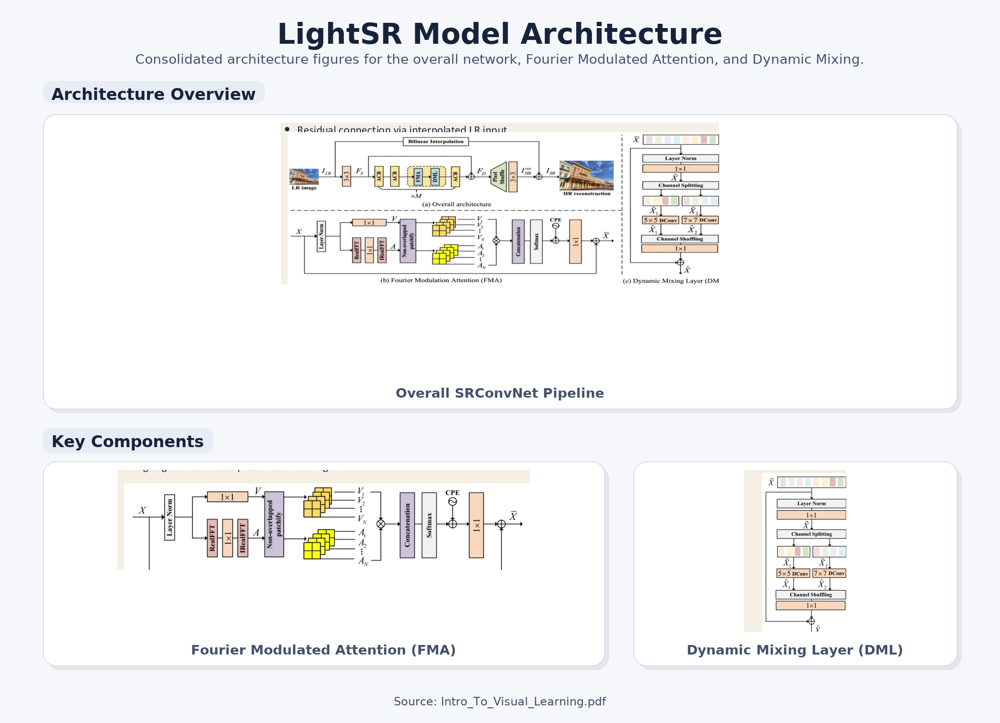
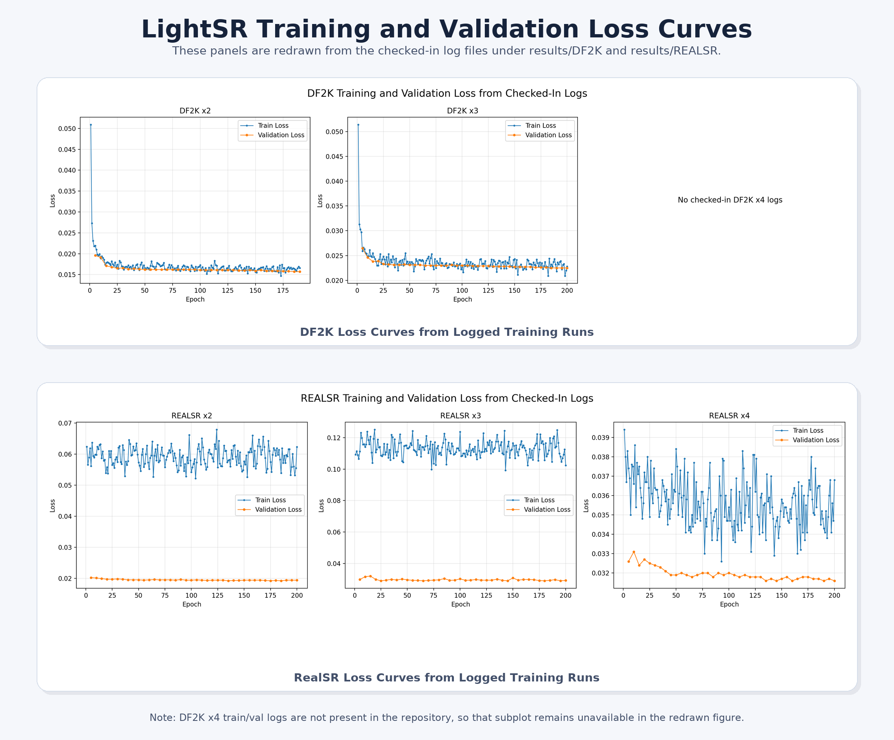
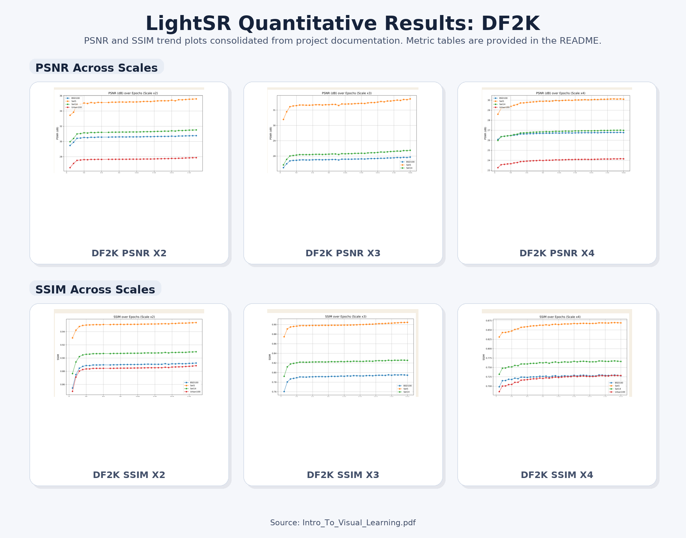
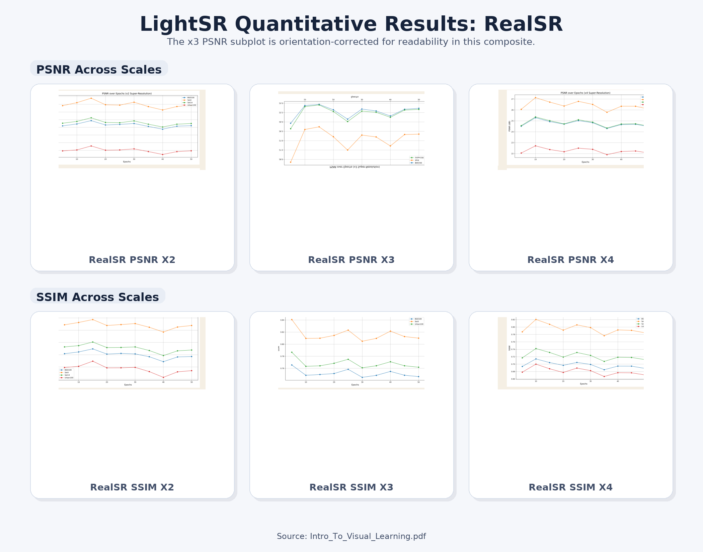
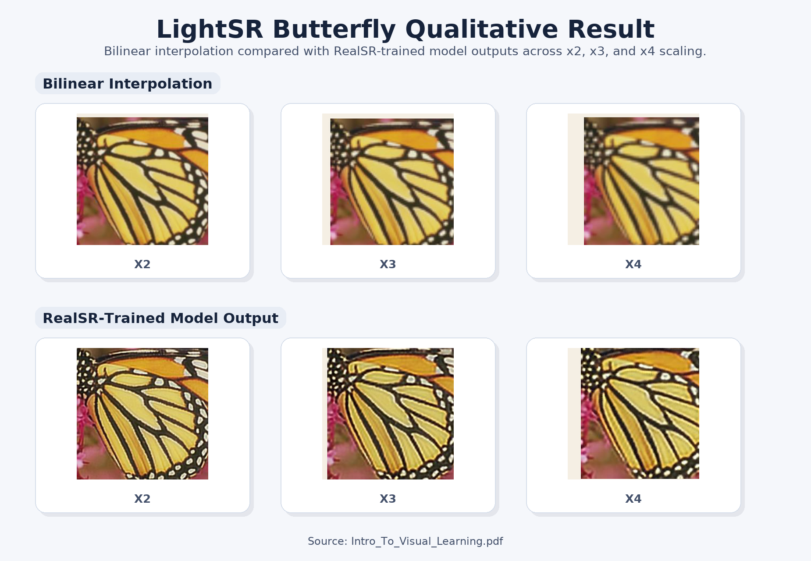

# LightSR: Lightweight and Efficient Image Super-Resolution

LightSR is a compact single-image super-resolution project built around an SRConvNet-style design for reconstructing high-resolution images from low-resolution inputs. The repository focuses on efficient reconstruction, practical model size, and stable behavior across both synthetic and real-world super-resolution settings.

## Core Idea

The project is built around three main requirements:

- preserve local texture and edge detail,
- model wider spatial structure without expensive full self-attention,
- and keep the reconstruction stack lightweight enough to remain practical.

At a high level, the model combines:

- a shallow convolutional feature stem,
- repeated **Attentive Convolutional Blocks (ACBs)**,
- **Fourier Modulated Attention (FMA)** for global context,
- **Dynamic Mixing Layers (DML)** for adaptive multi-kernel aggregation,
- and a residual upsampling path.

## Model Architecture

The cleaned architecture panel below consolidates the main network structure and the two most important internal components.



### End-to-End Mapping

Given a low-resolution input image `x in R^(3 x H x W)`, the model first extracts shallow features:

```math
f_0 = \mathrm{Conv}_{3 \times 3}(x)
```

Then a stack of attentive blocks refines those features:

```math
f_{i+1} = \mathrm{ACB}_i(f_i), \qquad i = 0,1,\dots,M-1
```

The final reconstruction is produced by a learned upsampling head together with a bilinear residual path:

```math
\hat{y} = R_s(f_M) + \mathrm{Bilinear}_s(x)
```

where `R_s(.)` denotes the scale-dependent reconstruction module and `s in {2, 3, 4}`. In the implementation, the `4x` case uses two successive `2x` shuffle stages for stability.

### Attentive Convolutional Block

Each attentive block is the composition of Fourier attention and dynamic mixing:

```math
\mathrm{ACB}(x) = \mathrm{DML}(\mathrm{FMA}(x))
```

This keeps the block structure simple while still separating global modulation from local adaptive aggregation.

### Fourier Modulated Attention

In the implementation, the input is normalized and then split into two paths: a Fourier path and a value path:

```math
x_n = \mathrm{LN}(x), \qquad S = \mathrm{FU}(x_n), \qquad V = \mathrm{Conv}_{1 \times 1}(x_n)
```

`FU` denotes the Fourier unit, which applies a real FFT, a learned `1 x 1` transform in the frequency domain, and then an inverse FFT. The resulting spectral features and value features are chunked across space and combined multiplicatively:

```math
A = \mathrm{softmax}\big(\mathrm{chunk}(S) \odot \mathrm{chunk}(V)\big)
```

The attention output is then combined with a depthwise positional term and projected back:

```math
\mathrm{FMA}(x) = \mathrm{Conv}_{1 \times 1}\big(A + \mathrm{DWConv}_{3 \times 3}(x)\big) + x
```

This gives the model a cheaper alternative to full spatial self-attention while still letting it react to long-range structure.

### Dynamic Mixing Layer

The dynamic mixing block first normalizes and expands the features:

```math
u = \mathrm{Conv}_{1 \times 1}(\mathrm{LN}(x))
```

The expanded tensor is split into two branches:

```math
[u_1, u_2] = \mathrm{split}(u)
```

Each branch is processed with a different dynamic kernel family:

```math
z_1 = \mathrm{Agg}_{5 \times 5}(u_1), \qquad z_2 = \mathrm{Agg}_{7 \times 7}(u_2)
```

The outputs are concatenated and projected back to the original channel width:

```math
\mathrm{DML}(x) = \mathrm{Conv}_{1 \times 1}([z_1; z_2]) + x
```

This gives the network two adaptive receptive fields in parallel and lets it blend fine and slightly broader context at each block.

### Dynamic Kernel Aggregation

The `Aggregator` module uses input-conditioned kernel weighting. If `{W_k}_{k=1}^K` are learned kernels and `alpha(x)` are attention coefficients generated from the current feature map, the effective kernel is:

```math
\alpha(x) = \sigma(\mathrm{MLP}(\mathrm{GAP}(x))), \qquad
W(x) = \sum_{k=1}^{K} \alpha_k(x) W_k
```

The convolution is then applied using `W(x)` instead of a single fixed kernel bank. This is the main adaptive mechanism inside the DML branches.

## Datasets

The repository materials reference the following training and evaluation datasets.

| Dataset | Role | Notes |
| --- | --- | --- |
| DIV2K / DF2K | Synthetic SR training | Clean high-resolution natural-image training data for `2x`, `3x`, and `4x` reconstruction |
| RealSR | Real-world SR training | DSLR-based paired LR/HR data with realistic degradations |
| Set5 | Evaluation | Standard benchmark with relatively simple visual structure |
| Set14 | Evaluation | Standard benchmark with moderate structural complexity |
| BSD100 | Evaluation | Natural-image benchmark used widely in SR evaluation |
| Urban100 | Evaluation | Harder benchmark with dense urban patterns and repeated structure |

## Training Behavior

The repository includes checked-in logs under `results/DF2K` and `results/REALSR`. Those logs were used to redraw the train/validation loss curves below.



### Loss Summary

| Scale | Training Loss | Validation Loss |
| --- | --- | --- |
| X2 | 0.0166 | 0.0150 |
| X3 | 0.0228 | 0.0225 |
| X4 | 0.0288 | 0.0264 |

`DF2K/4x` train and validation logs are not checked into this repository, so that specific subplot is not available in the redrawn figure.

## Quantitative Results: DF2K

The panel below packages the DF2K metric trends into a single cleaned figure.



### DF2K PSNR

| Model | BSD100 Max | BSD100 Final | Set5 Max | Set5 Final | Set14 Max | Set14 Final | Urban100 Max | Urban100 Final |
| --- | --- | --- | --- | --- | --- | --- | --- | --- |
| X2 | 30.77 | 30.77 | 35.59 | 35.59 | 31.52 | 31.52 | 27.88 | 27.88 |
| X3 | 27.94 | 27.94 | 31.73 | 31.73 | 28.38 | 28.38 | N/A | N/A |
| X4 | 26.79 | 26.77 | 30.13 | 30.10 | 27.01 | 26.99 | 24.16 | 24.15 |

### DF2K SSIM

| Model | BSD100 Max | BSD100 Final | Set5 Max | Set5 Final | Set14 Max | Set14 Final | Urban100 Max | Urban100 Final |
| --- | --- | --- | --- | --- | --- | --- | --- | --- |
| X2 | 0.8925 | 0.8925 | 0.9538 | 0.9538 | 0.9096 | 0.9096 | 0.8884 | 0.8884 |
| X3 | 0.7945 | 0.7945 | 0.9047 | 0.9047 | 0.8254 | 0.8254 | N/A | N/A |
| X4 | 0.7289 | 0.7278 | 0.8693 | 0.8689 | 0.7667 | 0.7660 | 0.7284 | 0.7285 |

### DF2K Reading

- `2x` is the strongest setting across the reported benchmarks.
- Accuracy decreases as the scale factor increases.
- Set5 is consistently easier than Urban100.
- The small gap between max and final values suggests stable convergence near the best epoch region.

## Quantitative Results: RealSR

The panel below summarizes the RealSR metrics. The `x3` PSNR subplot is orientation-corrected inside the composite for readability.



### RealSR PSNR

| Model | BSD100 | Set5 | Set14 | Urban100 |
| --- | --- | --- | --- | --- |
| X2 | 28.87 | 31.79 | 29.24 | 25.58 |
| X3 | 26.07 | 28.15 | 26.36 | N/A |
| X4 | 25.29 | 27.13 | 25.36 | 22.71 |

### RealSR SSIM

| Model | BSD100 | Set5 | Set14 | Urban100 |
| --- | --- | --- | --- | --- |
| X2 | 0.8695 | 0.9174 | 0.8807 | 0.8494 |
| X3 | 0.7656 | 0.8408 | 0.7867 | N/A |
| X4 | 0.7141 | 0.8205 | 0.7420 | 0.7000 |

### RealSR Reading

- RealSR is materially harder than the synthetic DF2K setup.
- The strongest reported performance again occurs at `2x`.
- Both PSNR and SSIM decline as the scale factor increases.
- The harder behavior is consistent with realistic degradations such as blur, noise, alignment issues, and device variation.

## Qualitative Result

The butterfly example below shows a direct visual comparison between bilinear interpolation and the RealSR-trained model outputs across `x2`, `x3`, and `x4`. The model outputs preserve wing boundaries and internal line structure more clearly than plain interpolation.



## Repository Layout

| Path | Purpose |
| --- | --- |
| `models/` | Main super-resolution model definition |
| `utils/` | FMA, DML, aggregation, layer normalization, and evaluation metrics |
| `dataset_utils/` | Dataset loading, patch cropping, caching, and helper utilities |
| `trainer/` | Training entry point and checkpoint logic |
| `scripts/` | Evaluation scripts, plotting helpers, and extraction tooling |
| `results/DF2K` | Checked-in DF2K train/validation logs |
| `results/REALSR` | Checked-in RealSR train/validation logs |
| `docs/assets/` | Cleaned images used by this README |
| `external_assets/` | Extracted tables, crops, and generated support files |

## Resources

| Resource | Link |
| --- | --- |
| Report PDF | [Project Report](LightSR_Project_Report.pdf) |
| Figure Source PDF | [Intro_To_Visual_Learning.pdf](Intro_To_Visual_Learning.pdf) |
| Checkpoints and Logs | [SharePoint Folder](https://ucsdcloud-my.sharepoint.com/:f:/r/personal/vmoparthi_ucsd_edu/Documents/LightSR?csf=1&web=1&e=fR56pw) |

Some remote resources may require institutional authentication.

## Reproducibility Notes

- The cleaned figures in this README are generated from checked-in logs and extracted documentation assets.
- The extraction helper for the table and crop assets is available at `scripts/extract_intro_visual_learning_assets.py`.
- Several training and evaluation scripts in the repository still contain environment-specific paths and should be cleaned further before reuse in a fresh environment.

## License

This repository is licensed under the **Apache License, Version 2.0**.

Copyright **2026** LightSR contributors.

See [LICENSE](LICENSE) for the full license text.
