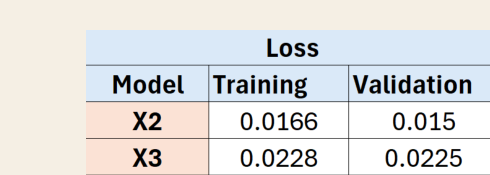
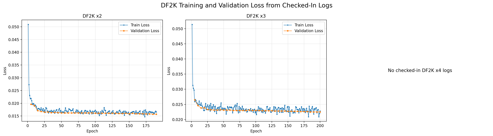
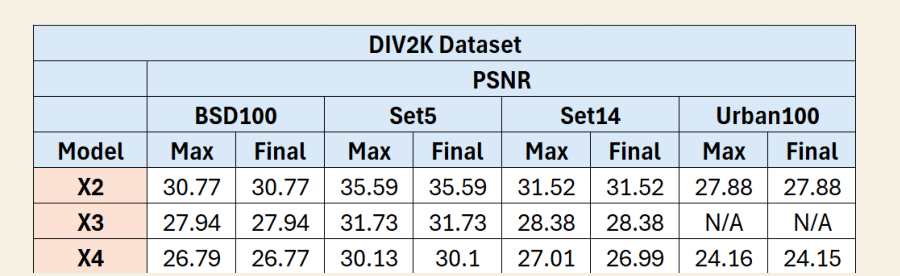
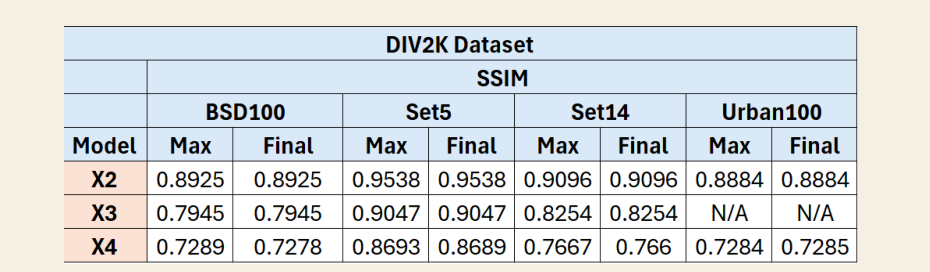
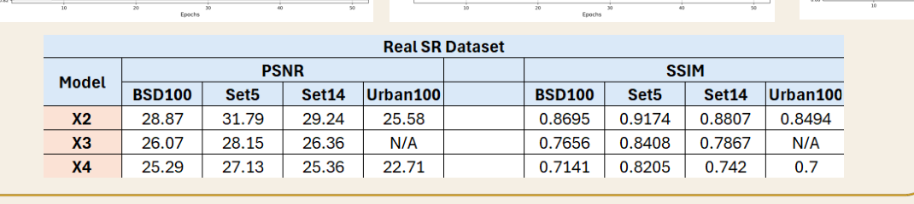
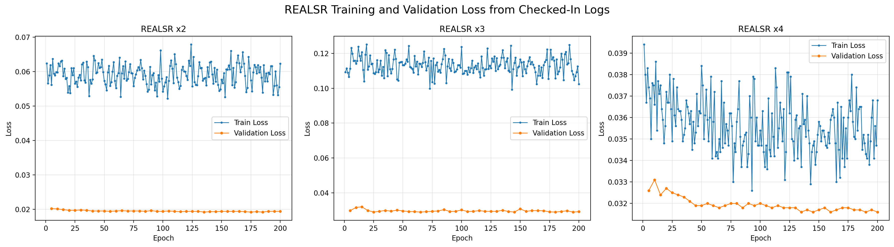

# Intro_To_Visual_Learning Extraction

Source PDF: `/mntdatalora/src/LightSR/Intro_To_Visual_Learning.pdf`

This file contains the tables transcribed from the slide deck plus links to the cropped PNG assets and the loss curves regenerated from checked-in logs.

## Slide 11: DIV2K Training and Validation Loss

| Model | Training | Validation |
| --- | --- | --- |
| X2 | 0.0166 | 0.015 |
| X3 | 0.0228 | 0.0225 |
| X4 | 0.0288 | 0.0264 |

Cropped assets:
- `pdf_crops/page11_loss_x2_plot.png`
- `pdf_crops/page11_loss_x3_plot.png`
- `pdf_crops/page11_loss_x4_plot.png`
- `pdf_crops/page11_loss_table.png`

Preview:

Redrawn from logs:
- `log_plots/df2k_train_val_loss_from_logs.png`

## Slide 12: DIV2K PSNR Table

| Model | BSD100 Max | BSD100 Final | Set5 Max | Set5 Final | Set14 Max | Set14 Final | Urban100 Max | Urban100 Final |
| --- | --- | --- | --- | --- | --- | --- | --- | --- |
| X2 | 30.77 | 30.77 | 35.59 | 35.59 | 31.52 | 31.52 | 27.88 | 27.88 |
| X3 | 27.94 | 27.94 | 31.73 | 31.73 | 28.38 | 28.38 | N/A | N/A |
| X4 | 26.79 | 26.77 | 30.13 | 30.1 | 27.01 | 26.99 | 24.16 | 24.15 |

Cropped assets:
- `pdf_crops/page12_psnr_x2_plot.png`
- `pdf_crops/page12_psnr_x3_plot.png`
- `pdf_crops/page12_psnr_x4_plot.png`
- `pdf_crops/page12_psnr_table.png`

Preview:

## Slide 13: DIV2K SSIM Table

| Model | BSD100 Max | BSD100 Final | Set5 Max | Set5 Final | Set14 Max | Set14 Final | Urban100 Max | Urban100 Final |
| --- | --- | --- | --- | --- | --- | --- | --- | --- |
| X2 | 0.8925 | 0.8925 | 0.9538 | 0.9538 | 0.9096 | 0.9096 | 0.8884 | 0.8884 |
| X3 | 0.7945 | 0.7945 | 0.9047 | 0.9047 | 0.8254 | 0.8254 | N/A | N/A |
| X4 | 0.7289 | 0.7278 | 0.8693 | 0.8689 | 0.7667 | 0.766 | 0.7284 | 0.7285 |

Cropped assets:
- `pdf_crops/page13_ssim_x2_plot.png`
- `pdf_crops/page13_ssim_x3_plot.png`
- `pdf_crops/page13_ssim_x4_plot.png`
- `pdf_crops/page13_ssim_table.png`

Preview:

## Slide 14: RealSR PSNR Table

| Model | BSD100 | Set5 | Set14 | Urban100 |
| --- | --- | --- | --- | --- |
| X2 | 28.87 | 31.79 | 29.24 | 25.58 |
| X3 | 26.07 | 28.15 | 26.36 | N/A |
| X4 | 25.29 | 27.13 | 25.36 | 22.71 |

## Slide 14: RealSR SSIM Table

| Model | BSD100 | Set5 | Set14 | Urban100 |
| --- | --- | --- | --- | --- |
| X2 | 0.8695 | 0.9174 | 0.8807 | 0.8494 |
| X3 | 0.7656 | 0.8408 | 0.7867 | N/A |
| X4 | 0.7141 | 0.8205 | 0.742 | 0.7 |

Cropped assets:
- `pdf_crops/page14_realsr_psnr_x2_plot.png`
- `pdf_crops/page14_realsr_psnr_x3_plot.png`
- `pdf_crops/page14_realsr_psnr_x4_plot.png`
- `pdf_crops/page14_realsr_ssim_x2_plot.png`
- `pdf_crops/page14_realsr_ssim_x3_plot.png`
- `pdf_crops/page14_realsr_ssim_x4_plot.png`
- `pdf_crops/page14_realsr_table.png`

Preview:

Redrawn from logs:
- `log_plots/realsr_train_val_loss_from_logs.png`

## Notes

- The `DF2K/4x` train and validation logs are not checked into this repository, so the x4 loss chart is available only as a PDF crop.
- The `page14_realsr_psnr_x3_plot.png` crop preserves the source slide exactly. In the source PDF, that embedded chart appears upside down.
